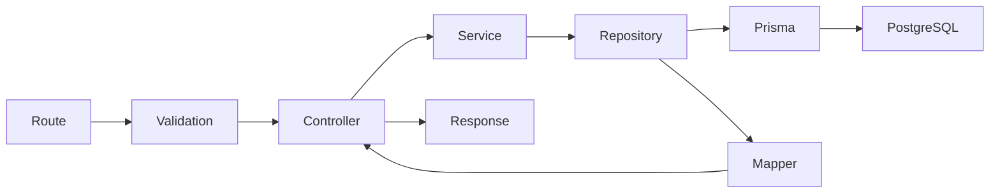

[← Project overview](../README.md) · [All documentation](../README.md#documentation)

# Taskflow architecture

## Request flow

| Layer      | Responsibility                                                           |
| ---------- | ------------------------------------------------------------------------ |
| Routes     | HTTP verbs, paths, authentication/role gates, validation middleware      |
| Validation | Joi schemas; reject unknown fields and invalid types before processing   |
| Controller | Read validated input, call a service, select status and shared response  |
| Service    | Business decisions, permissions, transaction boundaries                  |
| Repository | Prisma reads/writes and query filters; accepts transaction clients       |
| Mapper     | Select safe public fields, flatten relations, format dates/report values |

A layer is created when it has a responsibility: health needs no request-validation schema because its endpoint has no input.

## Modules

- auth: password verification, JWT cookies and current-user identity. Middleware reloads activation and role for each request.
- users: administration, directory search, public field mapping, responsibility checks.
- projects: project ownership, membership, team assignment, summaries and soft deletion.
- tasks: filters, assignment checks, status changes, comments and activity.
- analytics: dashboards and reports; the sole raw SQL boundary. SQL values are bound separately and authorization is applied before aggregation.
- health: database readiness through a Prisma repository.

## Common code

- response.js: success, paginated, noContent and failure.
- pagination.js: page offsets, metadata, literal search escaping and the UTC current day.
- date.js: date-only parsing and output, separate from database initialization.
- db.js: one Prisma client and a serializable transaction helper.
- common/scopes.js: reusable Prisma project/task filters for all record access. Analytics owns equivalent SQL predicates.

## Trace Create Task

1. task.routes.js runs authentication, role and Joi validation.
2. task.controller.js passes req.user and validated DTO to the service.
3. task.service.js starts a transaction and checks project scope, assignee membership/team and blocked reason.
4. task.repository.js creates the task and activity using the same transaction client.
5. task.mapper.js flattens project/assignee names and returns YYYY-MM-DD due dates.
6. The shared response helper sends HTTP 201 with success and data. A failure rolls back both writes.

## Consistency and security

Serializable transactions replace explicit SQL locks. Conflicts retry up to three attempts, then return HTTP 409. Transaction callbacks must contain database work only. This does not detect stale browser forms; optimistic version checking is a future improvement.

Database constraints enforce project membership, blocked reasons and completion timestamps. Services enforce active accounts and role-specific behavior. UI visibility is usability, not authorization. HttpOnly cookies reduce token exposure but do not eliminate XSS. Logout clears the cookie; individual JWT revocation is not implemented.

## API contract

Success: { success: true, data }. Lists additionally contain meta: { total, page, limit }. Errors: { success: false, error: { message, details } }. Deletions return HTTP 204 without a body. Password hashes are excluded by public mappers. The frontend api.js helper handles this envelope and unauthorized-session events centrally.

## Performance

Task lists use Prisma relation filters, server-side pagination and whitelisted sort fields. Project list counts use grouped queries for a whole page, avoiding per-project count requests. Analytics computes aggregates in PostgreSQL. Partial indexes support active records and overdue queries. Counts and pages are separate reads, so totals may shift during concurrent changes. Measure real query plans before adding indexes.

## Interview answers

**Why layers?** They separate HTTP, business rules, database operations and public representations, so changes have a clear home.

**Why repositories?** Services can express business decisions without embedding ORM queries. Repositories also share transaction clients.

**Why mappers?** Database relations and confidential columns should not determine public API output.

**Why SQL in analytics?** Joined filtered aggregates are concise in SQL; application CRUD remains Prisma.

**How do you prevent unauthorized ID access?** Scope every repository read to the authenticated user before returning a record.

**How do you test this?** Use an isolated PostgreSQL-compatible database initialized from the actual migration, seed it twice, then exercise allowed and denied HTTP requests. Native PostgreSQL checks cover migration application and concurrent transactions.

[Prisma transaction isolation and retries](https://www.prisma.io/docs/orm/v7/prisma-client/queries/transactions)

Native verification: four role scopes and dashboards agree; concurrent Admin deactivation keeps one active Admin. The initial seed contains exactly the documented counts.
